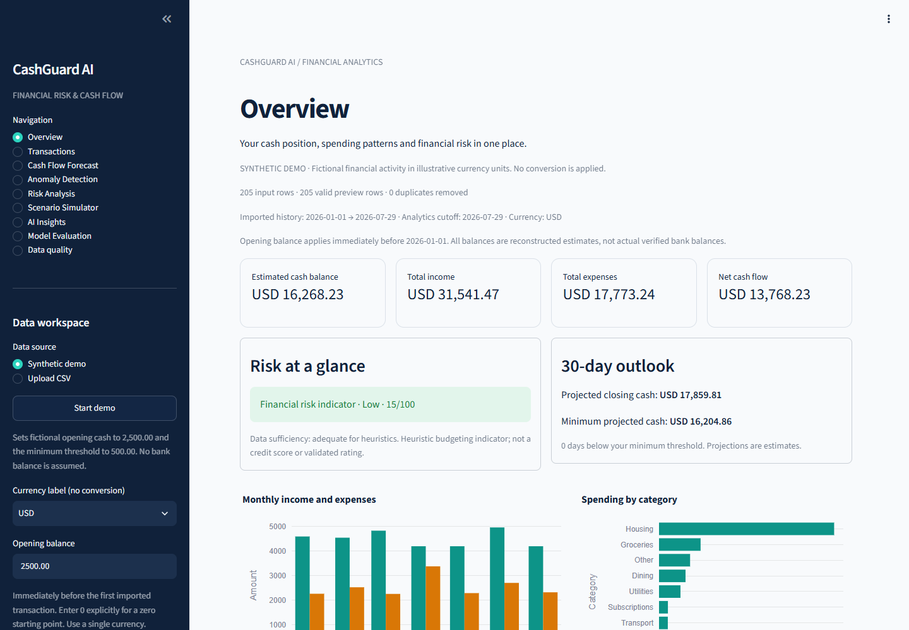

# CashGuard AI

A local financial analytics application for individuals, freelancers and small businesses.
Application code: [MIT](LICENSE). [Architecture diagram](docs/architecture.md) ·
[Release audit](docs/submission/RELEASE_AUDIT.md) ·
[Submission checklist](docs/submission/FINAL_CHECKLIST.md).



**Version 0.9: API-backed portfolio demo, private local analytics and bounded inference.** It imports transactions, reports data-quality issues,
and computes explainable historical summaries, deterministic cash-flow forecasts,
chronological Isolation Forest scores, heuristic risk indicators and what-if scenarios.
The Streamlit interface connects these engines across Overview, Transactions, Cash Flow
Forecast, Anomaly Detection, Risk Analysis, Scenario Simulator and AI Insights. The AI
Insights page optionally generates qualitative explanations through local Ollama,
defaulting to `gemma3:4b`. Calculated financial summaries work without any model.
The **Model Evaluation** page compares chronological forecasts with a naive
baseline and measures the calibrated review candidates alongside legacy Isolation Forest
on separately labeled synthetic transactions. **Data quality** completes the nine-page dashboard.
Anomaly Detection offers calibrated amount review, calibrated Isolation Forest and
the original Isolation Forest, with severity filters and recurring-payment context.

Phase 8 adds nine typed FastAPI endpoints, optional local MLflow, non-root Docker
services, a GitHub Actions quality workflow, private operational metrics/logs and offline
drift diagnostics. The financial engines and all nine dashboard pages retain their
direct local path. Portfolio Phase 9 integrates supported dashboard workflows with
FastAPI through the existing client; execution mode is environment-configured.
See the [Phase 8 guide and actual verification](docs/phase8_mlops.md) and
[architecture assessment](docs/phase8_architecture.md). The initial release passed
GitHub Actions; that historical run does not verify the unpushed portfolio changes.

See the [Phase 6 technical report](docs/phase6_anomaly_review.md),
[measured comparisons](reports/phase6/results.json), and
[interactive evaluation charts](reports/phase6/evaluation.html).
The [Phase 5 record](docs/phase5_evaluation.md) remains available, including its
poor legacy false-positive rate. New before/after comparisons use the same new final
examples; they do not equate the old holdout with the new one.
See the [Phase 7 QA record](docs/phase7_product_qa.md) for current executed checks,
browser evidence, Gemma status and remaining limitations. CashGuard is a local budgeting
research tool, not a bank, financial advisor or fraud detection service.

## Run locally (Windows PowerShell)

Use Python **3.12** (verified: 3.12.10). From the project directory:

```powershell
python --version
python -m venv .venv
.\.venv\Scripts\python.exe -m pip install -r requirements.lock.txt
.\.venv\Scripts\python.exe -m pip check
.\.venv\Scripts\python.exe -m pytest -q
.\.venv\Scripts\python.exe -m streamlit run app.py
```

If `python --version` reports an older interpreter, use `py -3.12 -m venv .venv`
or invoke the full path to your Python 3.12 executable. The Python launcher is optional.
An existing `.venv` prepared for this workspace uses Python 3.12.10. Activate it only if
you prefer; all commands above work without PowerShell execution-policy changes.
The fictional sample CSV is already bundled. Regenerate it only if missing or when
deliberately creating new sample data; the reproducibility commands below explain how.

Open **http://localhost:8501**. Stop with **Ctrl+C**. The server binds to loopback only.
For a guided first try, select **Synthetic demo → Start demo** in the sidebar. This
explicit action sets fictional opening cash to **2,500.00**, a minimum threshold of
**500.00**, and a USD display label. It does not retrieve or infer a bank balance.
For your own history, choose Upload CSV, select a currency label, and enter an opening
balance before the first imported transaction. Enter `0` explicitly to assume a zero
starting balance. Demo amounts use illustrative units; currency selection changes the
label only. Do not mix currencies or both sides of internal transfers in a dataset.

The existing workspace environment is ready to launch directly:

```powershell
.\.venv\Scripts\python.exe -m streamlit run app.py
```

If a running app reports `cannot import name` immediately after an update, stop
that Streamlit server with **Ctrl+C** and run the command above again, then refresh
the page. A long-running process can retain an older imported module even when the
new functions exist on disk. A successful health endpoint alone does not verify
page execution; startup and evaluation-page tests are available with:

```powershell
.\.venv\Scripts\python.exe -m pytest -q tests/test_app.py tests/test_model_evaluation_app.py
```

Use **Analysis date** to select the inclusive history cutoff and **Minimum cash threshold**
to configure alerts. Transaction-table filters do not change the opening-balance basis
or analytics history. Switch Light/Dark in the app's Settings menu. Streamlit 1.66+
is required for the verified interface and switchable theme configuration.

**Anomaly review engine** selects the review policy and recalculates anomaly/risk
results. The default uses the interpretable family chosen on separate synthetic
calibration data; its live threshold uses strictly earlier unlabeled transactions.
Warmup rows remain unscored. Zero alerts is not assurance of normal activity.
Severity is review priority, never fraud classification or probability.

See the [dashboard guide](docs/phase3_dashboard.md) for page controls, duplicate review,
session caching, downloads and deterministic insights.

## Optional local platform services

Run each long-lived service in a separate terminal from this directory:

```powershell
# API: http://127.0.0.1:8000/docs; metrics: http://127.0.0.1:8000/metrics
.\.venv\Scripts\python.exe -m api
# Optional tracking UI: http://127.0.0.1:5000
$env:MLFLOW_DISABLE_TELEMETRY = "true"
New-Item -ItemType Directory -Force var/mlflow | Out-Null
.\.venv\Scripts\python.exe -m mlflow server --host 127.0.0.1 --port 5000 --backend-store-uri sqlite:///var/mlflow/mlflow.db --workers 1
```

Explicit reproducible experiments and offline drift checks use fictional data:

```powershell
.\.venv\Scripts\python.exe -m scripts.evaluate_anomaly_candidates --calibration-only --output-dir reports/phase8/evaluation
.\.venv\Scripts\python.exe -m scripts.evaluate_anomaly_candidates --output-dir reports/phase8/evaluation --track-mlflow
.\.venv\Scripts\python.exe -m scripts.monitor_models --synthetic
```

Normal dashboard use does not record experiments. MLflow stores allowlisted synthetic
aggregates and charts, not raw transactions. Drift flags prompt review; they do not
automatically retrain models. Synthetic F1 0.9600 does not establish real-world accuracy.

Docker is an additional local option. Stop native services using the same ports first,
or use the alternate-port example in the [Phase 8 guide](docs/phase8_mlops.md):

```powershell
docker compose up -d --build --wait
# Include optional tracking:
docker compose --profile tracking up -d --build --wait
docker compose --profile tracking down
```

Host ports bind to loopback. Default containers use deterministic insights because
host Ollama is outside their loopback network. Native Python remains the verified
path for host Gemma; no model is downloaded into an image. `.env.example` documents
configuration. Local defaults remain loopback-only. Portfolio mode adds service
authentication and a restricted ingress; these controls are not security certification.

## Portfolio Phase 9: API mode and synthetic staging

This work follows the contest release and preserves its history and reports.
See the [architecture](docs/phase9_architecture.md),
[security boundaries](docs/phase9_security.md),
[deployment and rollback guide](docs/phase9_deployment.md), and
[executed quality gates](docs/phase9_testing.md).

Direct mode remains the default local command above. To try the API-backed dashboard,
start the API in one terminal, then start Streamlit in another:

```powershell
# Terminal 1
.\.venv\Scripts\python.exe -m api
# Terminal 2
$env:CASHGUARD_EXECUTION_MODE = "api"
$env:CASHGUARD_API_URL = "http://127.0.0.1:8000"
.\.venv\Scripts\python.exe -m streamlit run app.py
```

Use a fresh terminal or remove `CASHGUARD_EXECUTION_MODE` to return to direct mode.
If the API is unavailable, the UI shows an error; it does not silently switch engines.
Local API mode preserves validated private uploads (1 MiB / 2,000 rows at the API);
direct mode retains the existing 10 MiB CSV limit. Neither mode writes uploaded CSVs
to a financial database. Clear the current session before sharing a local browser.

For the separately isolated **synthetic-only** staging profile:

```powershell
$env:CASHGUARD_API_TOKEN = python -c "import secrets; print(secrets.token_urlsafe(32))"
$env:CASHGUARD_OPS_TOKEN = python -c "import secrets; print(secrets.token_urlsafe(32))"
docker compose -f compose.staging.yaml up --build -d --wait --wait-timeout 180
```

Open **http://localhost:8510**. Select **Start demo** or the landing-page walkthrough.
All nine pages remain available; public evaluation shows recorded synthetic results.
Uploads and public API/metrics/MLflow routes are blocked. Model explanations default
to explicitly labeled deterministic summaries. No GPU, hosted key or persistent disk
is needed. Stop with `docker compose -f compose.staging.yaml down`.

This is a single-instance demonstration, not a customer financial service. Quotas
reset on restart, and session state is lost when the process restarts. Optional hosted
Gemma is disabled pending approval and privacy/billing review. A prepared Render
configuration estimates 1 CPU / 2 GB at $25/month before other charges; no cloud service
has been created. Do not expose the raw Streamlit port as the public deployment.

Synthetic F1 **0.9600** is a replay of a known 247-example synthetic holdout, not a
fresh independent validation or evidence of real-world fraud-detection accuracy.
Unusual transactions are review candidates; zero alerts does not mean zero risk.

## Try the dashboard

On a narrow screen, use the top-left arrow to open the sidebar. The top-right menu
contains **Settings**, including Light / Dark / System display modes.

1. **Overview** — review estimated cash, income, expenses and net flow. Demo totals
   with the explicit starting assumption are USD 16,268.23 estimated cash,
   USD 31,541.47 income, USD 17,773.24 expenses and USD 13,768.23 net flow.
2. **Transactions** — filter dates, categories, descriptions and direction; download
   only matching rows. Filters persist while navigating. Replacing a file resets old
   review filters. These filters never change the financial history used by other pages.
3. **Cash Flow Forecast** — view 30 projected days, threshold dates and the expandable
   assumptions. Change **Minimum cash threshold** in the sidebar to recalculate alerts.
   This changes alerts and risk components, not recorded transactions or cash flows.
4. **Anomaly Detection** — review scores, severity, coverage warnings and historical
   comparisons. If the default demo has no alerts, choose **All scored** to inspect
   explanations, or deliberately select **Legacy Isolation Forest** to inspect its
   alerts and limitations. A flag is a review prompt; zero flags never establishes safety.
5. **Risk Analysis** — inspect all weighted contributions and data sufficiency. This
   is a heuristic budgeting indicator, not a credit score or externally validated rating.
6. **Scenario Simulator** — enter an emergency expense, reduce income, increase costs
   or delay a supported recurring inflow. Compare future curves and shortage dates;
   historical estimated cash remains fixed. Scenario controls survive page navigation.
7. **AI Insights** — calculated summaries work immediately. With local Ollama ready,
   explicitly click **Generate AI Insights** for optional evidence-linked explanations.
   Changing inputs invalidates old explanations. An unavailable model keeps the
   deterministic summaries and explains the fallback.
8. **Model Evaluation** — explicitly run a chronological forecast backtest, historical
   legacy benchmark or calibrated candidate comparison. These actions can take several
   seconds. The selected synthetic method achieved F1 0.9600 on 247 final examples
   (precision 1.0000, recall 0.9231); these figures do not establish real-world accuracy.
9. **Data quality** — inspect import findings and source previews. Invalid imports
   block every financial total until corrected, even if some rows are valid.

**Upload guidance:** choose Upload CSV in the sidebar and use **Download CSV template**
if needed. Uploading replaces the session's history; it does not merge files. Recheck
the opening balance and currency when replacing a file. Any previously entered cash
assumption remains visible until changed. **Clear session data** returns to a blank
starting assumption and releases app-held data. Close the tab when finished.

Raw uploaded transactions are held in the session, never in a shared application cache
or database. Ordinary page navigation and model metadata checks do not send financial
evidence to a model. Clicking Generate sends computed aggregates, not transaction
descriptions, merchant/account details or IDs, to a loopback Ollama endpoint. No cloud
model is used. This boundary does not guarantee how a separately configured local
Ollama service or your operating system manages memory/logs. Keep the server on loopback.

## Optional local Gemma setup

Install [Ollama](https://ollama.com/download) if needed. On Windows, open the installed
Ollama application; it normally starts the local server. If no server is running:

```powershell
$env:OLLAMA_NO_CLOUD = "1"
ollama serve
```

In another terminal, **only when you want to download the multi-gigabyte model**:

```powershell
ollama pull gemma3:4b
ollama list
```

CashGuard never downloads models automatically. If Ollama is already running, do not
start another server on the same port. To apply `OLLAMA_NO_CLOUD`, quit and restart
Ollama with that environment setting; setting it in an unrelated terminal does not
change an already-running server. Cloud-routed models are rejected by CashGuard.

Start CashGuard using the command above, open **AI Insights**, and click
**Generate AI Insights**. A connection/model check is automatic; inference is not.
Unavailable, timed-out or rejected model responses retain calculated summaries.
No paid API key is required. See the [Phase 4 guide](docs/phase4_local_ai.md) for the
local-only transport, evidence validation, privacy behavior, configuration and tests.

On Linux/macOS use `python3 -m venv .venv`, followed by `.venv/bin/python` in place
of `.\.venv\Scripts\python.exe`.

Runtime requirements are in `requirements.txt`; `requirements-dev.txt` adds Pytest.
`requirements.lock.txt` records the complete environment used for verification:

```powershell
.\.venv\Scripts\python.exe -m pip install -r requirements.lock.txt
```

The lock was generated on Windows/Python 3.12; use the requirements files to resolve
dependencies on other platforms. No paid APIs, cloud account or Ollama installation
is needed for the implemented phases. Package installation needs network access.

## CSV contract

UTF-8 (optional BOM), comma separated, unique nonblank headers, at most 10 MiB and
100,000 transactions. Required columns:

```csv
date,description,amount,category
2026-01-01,Salary,4200.00,Income
2026-01-03,Rent,-1400.00,Housing
2026-01-05,Groceries,-75.25,Groceries
```

- `date`: real calendar date, strictly `YYYY-MM-DD`; no ambiguous local dates or timestamps.
- `description`, `category`: nonblank text. Descriptions are at most 500 characters;
  categories at most 100. Custom categories are retained in title case.
- `amount`: finite signed decimal, at most two nonzero decimal places and magnitude
  below 10 billion. Positive is income, negative is expense; zero is allowed.
  Currency symbols and thousands separators are unsupported. All amounts share one
  currency with two decimal minor units.
- Optional `transaction_id`, `account`, `merchant`: text (at most 200 characters).
  Leading zeros are preserved; blank optional values become missing values.

Headers are trimmed and lowercased, text fields trimmed, category whitespace collapsed,
and aliases standardized (for example `payroll` → `Income`, `rent` → `Housing`,
`grocery` → `Groceries`). Other columns are ignored with a warning. Physically blank
lines are ignored. Quoted commas and multiline fields are supported.

The importer never changes an input file. Reports identify the **ending physical CSV
line**, including headers, so multiline records can span multiple lines.

### Duplicate policy and import errors

Identical normalized records sharing `(account, transaction_id)` are removed with a
warning. Conflicting records sharing that identity are all excluded and generate
blocking errors; correct them in the source. IDs are assumed unique within an account
in this single-file import. Different IDs and different accounts remain distinct.

Identical rows **without IDs are retained and flagged**: repeated purchases can be
legitimate. The sidebar provides an explicit opt-in to remove those normalized repeats.
The dashboard blocks analytics until you either remove them or explicitly confirm they
represent separate transactions. The transaction table remains available for review.
Re-uploading a file replaces the current analysis; imports are not merged or persisted.

Row errors produce a preview of valid rows, but **any error blocks the financial
dashboard**. Fatal file, encoding, parsing or size errors discard the whole parse.
No partial totals are presented as a successful import. Validation logs record only
counts and status, never transaction values or histories.

## Available analytics and assumptions

- Income = sum of positive amounts; expenses = absolute sum of negative amounts.
- Net cash flow = income − expenses.
- Estimated closing balance = user-entered opening balance + net cash flow.
- Balance history groups transactions by date and estimates each observed day's
  closing balance. It makes no claims about intraday ordering or missing days.
- Monthly income, expenses and net flow include observed transactions only. Partial
  months are not extrapolated; absent months are not fabricated as zero activity.
- Category spending includes expenses only. Transaction filters affect the transaction
  table and download; Overview summarizes all successfully imported rows through the
  sidebar analysis date.

Validation uses Pydantic; monetary values are stored as `Decimal` and integer cents.
Core totals use exact integer arithmetic. Aggregated chart coordinates are converted
to floating-point units for plotting. This is a cash-flow convention, not accounting:
refunds and transfers need correct preprocessing, and completeness of uploaded data
cannot be verified. An imported transaction log does **not** establish an actual bank
balance. All reconstructed balances are labeled estimates.

## Reproducible fictional data

The included CSV covers **210 calendar days**, starting January 1, 2026, with monthly
salary, rent, subscriptions, utility bills, weekly groceries, commuting, dining,
irregular freelance income and unexpected repairs. All entities and IDs are fictional.
The fixed dates prevent output changing with the system clock; NumPy's local generator
uses seed `42` without changing global random state. Randomness generates sample
history only; future projections will be deterministic.

```powershell
.\.venv\Scripts\python.exe scripts/generate_sample_data.py --days 210 --seed 42 --start-date 2026-01-01
```

`--output PATH` writes another sample file. Generation replaces that output path;
use a separate path for experiments. At least 180 days are required.

## Phase 2 core analytics

Run all four analytics modules on the bundled fictional history from the command line:

```powershell
.\.venv\Scripts\python.exe -m scripts.analyze_sample --opening-balance 2500.00
```

The command prints a JSON report containing computed forecast, anomaly, risk, scenario
and rolling-backtest results. `--as-of 2026-06-30` optionally sets an inclusive history
cutoff; later transactions are excluded. The sample runner uses a 30-day horizon, a
500-unit alert threshold and an illustrative scenario of 20% less income, 10% higher
expenses, and a 500-unit emergency on the first projected day. These are explicit
demonstration assumptions, not recommendations.

The [Phase 2 technical guide](docs/phase2_analytics.md) documents the Python APIs,
event ledger, recurring-pattern rules, leakage protections, risk thresholds, scenario
rounding, measured evaluation results and model limitations. Business logic remains
independent of Streamlit. No additional dependencies were needed for this phase.

## Known limitations

- Imported history cannot prove completeness or reconcile an actual bank balance.
  Opening cash is an explicit assumption. Transfers, refunds and multiple currencies
  need preprocessing; no bank connectivity or exchange-rate conversion is included.
- Forecasts repeat supported historical patterns and averaged residual spending.
  They do not anticipate unknown payments, economic changes or intraday ordering,
  and offer no calibrated prediction interval or guaranteed minimum cash balance.
- Anomaly warmup is unscored, not normal. Scores and calibration percentiles are not
  fraud probabilities. Sparse histories and new transaction patterns reduce coverage.
- Risk weights are transparent heuristics, not regulated, credit or investment ratings.
  Synthetic benchmark labels describe injected changes, not real financial incidents.
- Gemma is optional and may be slow or produce rejected text. Structural/evidence
  validation reduces unsupported numeric claims but cannot prove every interpretation.
  Deterministic summaries remain available; this is general budgeting research.
- Data lives in the current local session. Refreshing or closing it can reset work;
  no database, authentication, shared-user isolation guarantee or production hosting
  is provided. Desktop/mobile checks use headless Edge viewport emulation; physical
  touch devices, Safari, screen readers and a complete accessibility audit remain untested.

## Troubleshooting

| Symptom | Action |
| --- | --- |
| `ERR_CONNECTION_REFUSED` at localhost:8501 | Run the Streamlit command from this project directory and keep its terminal open. Check its output for startup errors. Open `http://127.0.0.1:8501` directly. An editor preview alone does not start the server. |
| `cannot import name` after an update | Stop the old CashGuard Streamlit process, restart it using the workspace `.venv`, then refresh. Do not reinstall or replace working modules to resolve a stale process. |
| Port 8501 is already occupied | Open the existing CashGuard instance if it is the intended server. Otherwise choose `--server.port=8502` and open that port. |
| No estimated balance or financial cards | Enter opening cash explicitly, including `0`, or click Start demo for fictional assumptions. Complete duplicate review and correct every CSV validation error. |
| Valid rows appear but totals are blocked | The validation table identifies the erroneous field and ending source line. Correct the original CSV and upload it again; partial valid rows are preview only. |
| A transaction seems missing | Clear table search/date/category/direction filters. Check Analysis date for analytics. Table filters persist across pages, but reset for replacement files. |
| No anomalies or no backtest scores | Review warmup and data-sufficiency messages. Default demo zero alerts is expected under the calibrated policy. Backtesting needs at least 90 training days plus a complete future horizon. |
| Gemma is unavailable | Start local Ollama, run `ollama list`, check the selected name, and install the model only if desired. Use Check local model connection. Calculated summaries need no model. |
| Gemma times out or its response is rejected | Keep the deterministic fallback, retry explicitly, or raise the UI timeout up to 180 seconds. Large models can exceed local RAM/compute limits; validation failures are not displayed as AI insights. |
| PowerShell activation is blocked | Use `.\.venv\Scripts\python.exe` directly; activation and execution-policy changes are unnecessary. |

## Structure

```text
app.py                         Streamlit entry point, source/configuration and session state
config.py                      Shared limits, paths and sample defaults
requirements*.txt              Runtime, test dependencies and verified environment
pyproject.toml                 Python requirement and Pytest configuration
.streamlit/config.toml         Theme, loopback binding, telemetry disabled
data/synthetic_transactions.csv
src/
  data_processing.py           Transaction schema, CSV validation, duplicates
  metrics.py                   Exact totals, monthly/category/day summaries
  visualizations.py            Theme-aware historical, forecast, anomaly and risk charts
  analytics_utils.py           Date-bounded analytics input contracts
  forecasting.py               Recurring/residual projections and rolling backtests
  anomaly_detection.py         Training-only features and chronological scoring
  risk_engine.py               Explainable heuristic contributions
  scenario_simulator.py        Validated, deterministic event-ledger scenarios
  dashboard_service.py         UI-independent orchestration, filtering, export and summaries
  financial_context.py         Validated, minimized financial evidence for local inference
  insight_prompts.py           Prompt templates, schema and output guardrails
  llm_service.py               Local-only Ollama transport, model checks and bounded inference
  insight_workflow.py          Validated explanations or deterministic fallback reports
  ui/
    components.py              Theme-compatible styling and shared Streamlit components
    pages.py                   Page renderers and scenario controls
    ai_insights.py             User-triggered inference and context-bound session results
scripts/generate_sample_data.py
scripts/analyze_sample.py       Run the complete core pipeline locally
scripts/check_local_ai.py       Model availability or explicit synthetic-data inference check
scripts/evaluate_models.py      Reproduce measured evaluations, timings and offline charts
src/evaluation.py              Matched rolling forecasts and chronological anomaly evaluation
src/evaluation_data.py         Fictional benchmarks with separate injection labels
src/explainability.py          Training comparisons, ranked risk factors and breach reconciliation
src/ui/model_evaluation.py     Explicit evaluation with private session storage
docs/phase2_analytics.md        API contracts, assumptions and evaluation results
docs/phase3_dashboard.md        Dashboard behavior, caching and local verification
docs/phase4_local_ai.md         Local Gemma setup, evidence guardrails and validation limits
docs/phase5_evaluation.md       Financial audit, measured results, performance and limitations
reports/phase5/                Synthetic results, predictions, labels and standalone charts
tests/
  conftest.py                   Shared validated financial fixtures
  test_data_processing.py      Import contracts and failure cases
  test_metrics.py              Monetary arithmetic and reconciliation
  test_synthetic_data.py       Data validity, coverage and reproducibility
  test_app.py                  Streamlit execution and control flows
  test_forecasting.py          Forecast arithmetic, calendar edges and held-out folds
  test_anomaly_detection.py    Warmup, frozen fit statistics and temporal isolation
  test_risk_engine.py          Threshold boundaries, missing factors and report cutoffs
  test_scenarios.py            Exact changes, deferred payments and input validation
  test_phase2_integration.py   Bundled sample through all four core modules
  test_dashboard_service.py   Dashboard contracts, exact exports and session isolation
  test_dashboard_charts.py    Plotly series matched against engine outputs
  test_dashboard_app.py       Page navigation, uploads, recalculation and scenario state
  test_financial_context.py   Context integrity, missing values and minimized private data
  test_insight_prompts.py     Evidence, quantity, injection and scope validation
  test_llm_service.py         Mocked model checks, local transport, errors and retry bounds
  test_insight_workflow.py    Deterministic fallbacks and report validation
  test_ai_insights_app.py     Explicit inference, stale-result invalidation and graceful failure
  test_evaluation.py          Matched baselines, error arithmetic, separate labels and leakage
  test_phase5_invariants.py   Cross-module ledgers, projection validation and risk boundaries
  test_explainability.py      Training-only comparisons and threshold reconciliation
  test_phase5_llm.py          Mocked end-to-end privacy and calendar validation regressions
  test_model_evaluation_app.py Explicit evaluation, invalidation and genuine chart values
```

Business logic is independent of Streamlit. Tests run locally with no external services.
UI tests use Streamlit AppTest; they check script execution and controls, not browser
layout. Raw histories are not sent to any service by application code. Uploads are
processed in memory; there is no database or persistent upload storage. The generated
sample and generated evaluation CSVs are entirely fictional; local uploads,
environments and secrets are ignored.

### Verified Phase 1 results

On October 17, 2026, with Windows and Python 3.12.10:

- `python -m pytest -q`: **53 passed in 2.38s**, no failures or skips.
- `python -m pip check`: **No broken requirements found**.
- Generator: **205 transactions across 210 calendar days**; validity and fixed-seed
  reproducibility are covered by tests.
- Streamlit launch smoke check: local health endpoint returned **HTTP 200 / ok**;
  the temporary check server was then stopped.

Pytest uses `.pytest_cache/tmp` for temporary files to avoid restrictions in the
shared Windows temporary directory. No visual browser inspection was performed.

### Verified Phase 2 results

On October 17, 2026, with the same environment, the full suite reported
**135 passed in 27.03s**, with no failures or skips. This includes all 53 existing
tests and 82 new tests. `python -m pip check` reported **No broken requirements found**.
The sample analytics command completed successfully. Evaluation numbers and the
validation boundaries are recorded in the [technical guide](docs/phase2_analytics.md).

### Verified Phase 3 results

On October 17, 2026, with Windows, Python 3.12.10 and Streamlit 1.66.0:

- Full suite: **167 passed in 60.79s**, no failures or skips. This retains all 135
  existing tests and adds 32 dashboard integration, chart and UI cases.
- Dependency check: **No broken requirements found**.
- Streamlit startup: health endpoint **HTTP 200 / ok** and application entry **HTTP 200**;
  the temporary launch-check server was stopped afterward.
- A navigation regression found during final verification was fixed: scenario inputs
  now survive switching to Insights and returning. The final full run includes that check.

Tests exercise actual uploaded-file widgets and all analytics pages. Browser appearance
and mobile screenshots were not visually inspected. Details and verification boundaries
are in the [dashboard guide](docs/phase3_dashboard.md).

### Verified Phase 4 results

On October 17, 2026, in the existing Python 3.12.10 environment:

- Full suite: **247 passed in 65.60s**, no failures or skips: all 167 previous tests
  plus 80 new Phase 4 cases. Automated Ollama tests use mocks and require no model.
- Dependency check: **No broken requirements found**.
- Running dashboard: health and application-entry endpoints returned **HTTP 200**;
  the existing server was left running.
- Real local compatibility command using the installed `qwen2.5:3b` and fictional
  sample data returned `source: ai`, no error code and **five validated sections**.
- Default `gemma3:4b`: **not installed and not inference-tested**. No model was downloaded.

Earlier invalid live responses were rejected and fell back to deterministic summaries.
The final successful alternate-model check does not establish Gemma compatibility on
this machine. See the [Phase 4 guide](docs/phase4_local_ai.md) for the exact checks,
file inventory and remaining qualitative-validation limitations.

## Phase 5 evaluation and verification (historical)

Reproduce the bundled synthetic evaluation and three timing repetitions per size:

```powershell
.\.venv\Scripts\python.exe -m scripts.evaluate_models --repeats 3 --check-local-llm
```

This writes `reports/phase5/results.json`, forecast folds/predictions, the separately
labeled anomaly holdout, and an offline Plotly HTML report. The optional real-model
check uses fictional evidence, contacts only local Ollama and never downloads a model.
Omit `--check-local-llm` for a fully service-independent run. Add `--skip-performance`
for a faster metrics-only run; use a different `--output-dir` to preserve saved timings.

The dashboard's Model Evaluation page runs only when its buttons are clicked.
Forecast evaluation uses the selected history, cutoff, opening balance and income
assumption. The labeled anomaly benchmark always uses its own fictional dataset,
independent of uploads. No synthetic accuracy is attributed to an unlabeled upload.

Measured 30-day daily-net MAE / RMSE / bias: **44.58 / 115.33 / -1.13** currency units.
Reconstructed-balance MAE / RMSE / bias: **207.78 / 278.13 / -79.63**, versus
**2316.42 / 2403.09 / -2316.34** for last-balance persistence. Each method uses the
same four origins and 120 origin/date observations. Bias is prediction minus actual.

Synthetic anomaly precision / recall / F1: **0.0779 / 1.0000 / 0.1446**;
false-positive rate **0.6228**, confusion matrix `[[86, 142], [0, 12]]`
(rows: background/injected, columns: not flagged/flagged). The unchanged auto threshold
needs independent calibration; it was not tuned against these test labels.

The [technical report](docs/phase5_evaluation.md) records the final test run,
machine-specific timings, financial audit, test coverage, and exact reproduction steps.
Final suite: **297 passed in 36.74s, 0 failed, 0 skipped**. Dependency checks passed.
Local Streamlit health returned **HTTP 200 / ok**. Gemma remained uninstalled,
so Phase 5 real Gemma inference and response timing are unavailable.

## Phase 6 anomaly optimization and verification

Use the declared training/calibration/final protocol to reproduce model selection
before opening the final partition:

```powershell
.\.venv\Scripts\python.exe -m scripts.evaluate_anomaly_candidates --calibration-only
.\.venv\Scripts\python.exe -m scripts.evaluate_anomaly_candidates
```

The selected category-relative robust amount model with recurring context had final
precision **1.0000**, recall **0.9231**, F1 **0.9600**, and observed FPR **0/234**.
It missed one of thirteen injected amount changes. The original forest on the same
247 examples had precision **0.1204**, recall **1.0000**, F1 **0.2149**, and FPR
**95/234**. Final labels did not select the model or its threshold. These small
synthetic results do not establish real-world accuracy or a zero population FPR.
The calibrated forest remains available; the simpler model won calibration selection.

Gemma `gemma3:4b` is now installed. Real full/sparse evidence checks produced five
validated sections in **6.33 / 7.10 seconds**; a one-second timeout probe retained
the deterministic fallback. No model download was performed. To repeat the explicit
fictional-data inference checks and live dashboard execution checks:

```powershell
.\.venv\Scripts\python.exe -m scripts.validate_local_ai
# Keep Streamlit running in another terminal for this command:
.\.venv\Scripts\python.exe -m scripts.smoke_dashboard
```

The latter exercises actual local Streamlit sessions, not browser visual appearance.
Model Evaluation has a separate **Run calibrated candidate comparison** button;
it shows matched candidate metrics, calibration evidence, confusion matrices and
score distributions. The [Phase 6 report](docs/phase6_anomaly_review.md) contains
the final test record, root causes, limitations and complete file inventory.
Final suite: **333 passed in 53.01s, 0 failed, 0 skipped**. Dependency checks passed;
all nine pages and both evaluation workflows executed in a live local session.

Forecast backtest errors are measured on synthetic history; no real-world accuracy,
fraud probability, credit score or regulated risk validation is claimed.
Transaction-history persistence is optional future work. GitHub publishing, deployment,
competition submissions, live banking and trading are outside the current scope.

## Phase 7 product QA

On October 18, 2026, the expanded suite passed **338 tests** with no failures or
skips, and dependency checks found no broken requirements. All **12 requested user
journeys** were exercised in an actual local Edge browser, including real Gemma,
missing-model fallback, valid/invalid uploads and all evaluation actions. A separate
live Streamlit protocol run passed **15 execution checks**.

Browser QA covered all nine pages at desktop and narrow widths in light/dark modes
(36 combinations), with scrolling screenshots. Physical devices, Safari and a full
accessibility audit remain untested. The selected synthetic anomaly result remains
F1 **0.9600**; replaying this known holdout is not new independent validation.

See the [Phase 7 QA report and changed-file inventory](docs/phase7_product_qa.md),
[browser journey evidence](reports/phase7/browser_journeys.json),
[screenshot manifest](reports/phase7/screenshots/manifest.json) and
[real Gemma checks](reports/phase7/local_gemma.json). Phase 5/6 reports and frozen
selection artifacts remain unchanged. Phase 7 evaluation outputs live under
`reports/phase7/` to keep the earlier records reproducible.

## Phase 8 verified local platform

The original baseline passed 338 tests before changes. The final suite passed
**451 tests, 0 failures, 0 skips** on Windows (88.88s) and in a non-root offline Linux
QA container (55.44s). All original tests remain; 113 tests were added. Dependency,
critical lint and compilation checks passed. Two upstream deprecation warnings remain.

Native and container services each passed **13 HTTP checks** and **15 dashboard
execution checks**. All three container images built and ran healthy as UID 10001.
Seven native and two container MLflow experiments were read back as finished, with
aggregate/chart artifacts. Real Gemma insights through the API passed in **7.42s**,
along with missing-model and timeout fallback checks. The synthetic anomaly F1 stayed
**0.9600**. These are local results; **GitHub Actions has not run**.

The offline synthetic drift report flags the deliberately shifted amount/category/ratio
distributions and also finds a background-window ratio difference requiring review.
Alert-rate and realized-residual drift remain unassessed without their required inputs.
Full dashboard API-mode migration is deferred; all nine pages keep direct analytics.
Phase 8 did not repeat visual screenshot QA. See the
[verification report and file inventory](docs/phase8_mlops.md),
[machine-readable results](reports/phase8/final_verification.json), and
[readable drift report](reports/phase8/drift/monitoring.md).

## Phase 9 release and demonstration

The release audit reran the baseline (**451 tests passed**) before changes. Screenshot
review found one financial display defect: a currency-prefixed negative scenario delta
appeared as a green upward indicator. The sign now precedes the currency label; a new
Streamlit regression test verifies the decrease. Financial calculations were unchanged.
Clean-source testing also found that pytest's temporary directory depended on an
existing cache folder. The configuration now uses a top-level ignored temporary
directory, with a fresh-checkout regression. Six release-packaging/privacy tests
were added in total. The final Windows suite passed **458 tests, 0 failures, 0 skips
in 85.73s**, with two upstream deprecation warnings.
The extracted source release candidate also passed all **458 tests in 90.05s**,
without relying on the workspace's ignored caches or stores.
Hosted GitHub Actions success is still unverified.

The [submission directory](docs/submission/FINAL_CHECKLIST.md) contains the article
draft, actual screenshots, a real browser recording, narration/shot plan and publication
instructions. The ordinary demo has no default anomaly alerts. The anomaly scene
explicitly loads a separate [existing synthetic benchmark](docs/submission/assets/synthetic-anomaly-benchmark.csv)
with known injections and shows an actual flag from the default engine. No financial
amount was changed to make the demonstration look more impressive.

The owner selected MIT and identified the intended repository as
[MoAftab-01/CashGuard-AI](https://github.com/MoAftab-01/CashGuard-AI). It was public with
no branches at audit time; code upload requires explicit approval. No code push,
repository visibility change or DEV publication has been performed. A local video file
is not a publicly accessible demo URL. Follow the checklist before claiming submission.

The [release allowlist](scripts/prepare_release.py) creates a reviewed source archive
with `python -m scripts.prepare_release --build`. It excludes private stores, model
weights, raw logs, virtual environments, caches, arbitrary CSVs and historical screenshot
archives. Original local reports remain intact; new reviewed submission assets are the
public visual evidence. Pattern scanning is not a guarantee against every possible leak.

Gemma is open-weight and retains its [separate model terms](https://ai.google.dev/gemma/terms).
Model weights are not bundled. See [security/privacy guidance](SECURITY.md) and
[contribution instructions](CONTRIBUTING.md).

The challenge cutoff is October 18, 2026 at 11:59 PM PDT (October 19 at 12:29 PM IST).
On October 18, 2026, the owner confirmed project start within the entry window and
personal eligibility checks; the organizers retain the final eligibility decision.
No specific start date, customer, payment, testimonial or agent-session
link has been invented. Any commits after that cutoff must be identified here honestly;
no post-deadline work is claimed at this preparation time.
