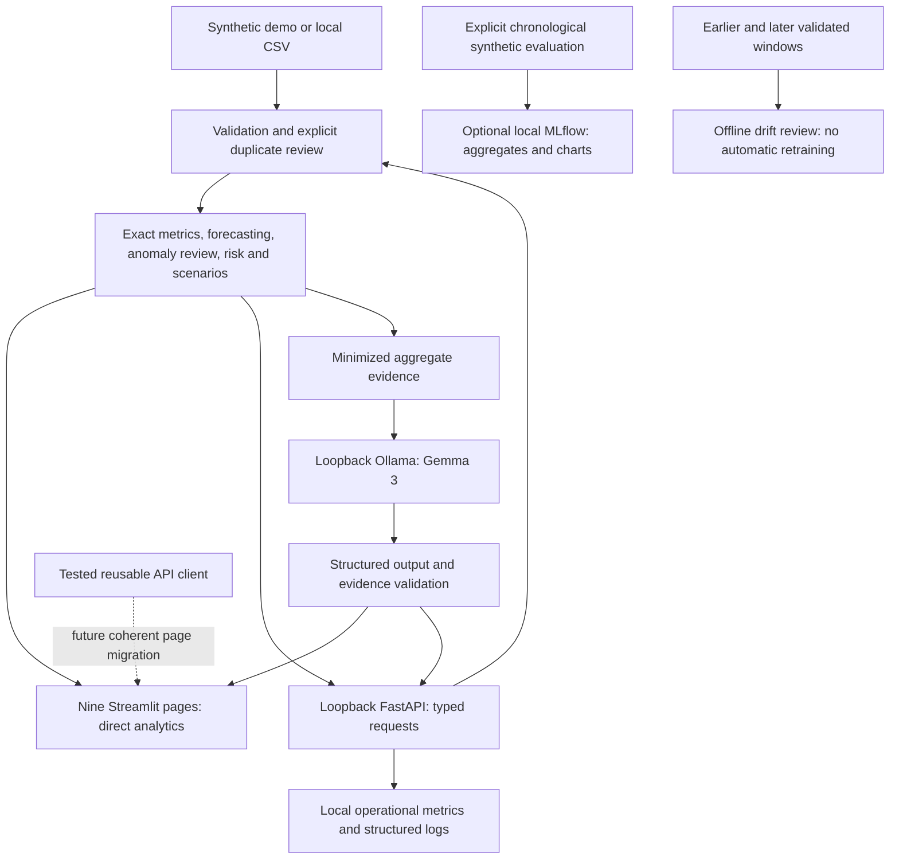

# CashGuard AI architecture

The dashboard currently calls the engines directly. FastAPI is an additional interface
to those same engines; no incomplete API-mode toggle is shipped. Docker adds an
execution option. Native Python remains the verified way to reach host Ollama without
loosening the strict loopback model boundary. Raw CSVs are not persisted by the API.

Gemma explains computed evidence. Python owns monetary calculations. Model text is
validated before display; qualitative errors can still occur. Failed or unavailable
generation retains deterministic summaries. Financial estimates, heuristic risk and
unusual-transaction review are not bank balances, credit ratings or fraud decisions.

See [Phase 8 architecture](phase8_architecture.md) for the implementation audit and
[operations guide](phase8_mlops.md) for exact contracts and limitations.
