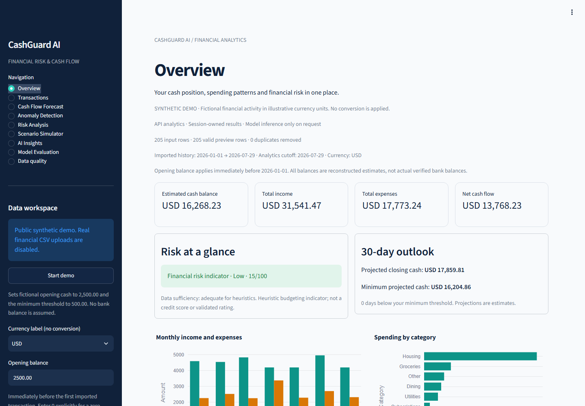
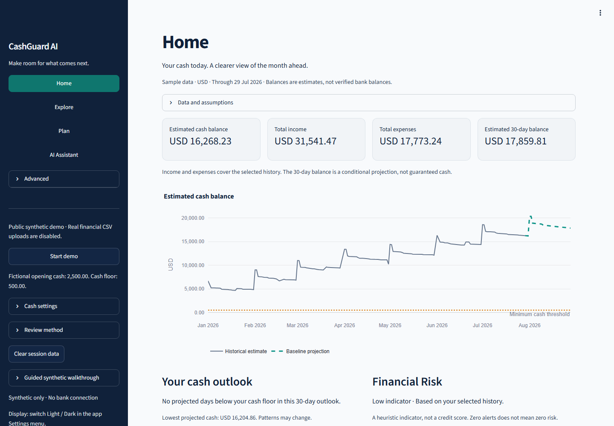

# Phase 10A UX audit — before implementation

Reviewed October 20, 2026, at commit `6a1f587`. This audit precedes the redesign.
Scope: all nine page renderers, shared shell, AI direct/API paths, existing UI tests,
and the Phase 9 rendered desktop/mobile screenshots and 36-layout browser report.
No user study or measured 30-second comprehension result is claimed.

## Findings ranked by user impact

| Priority | Location | Observed issue | Proposed treatment |
|---|---|---|---|
| High | Shared navigation | Nine equally weighted technical views; setup and model controls compete with navigation | Four task areas: Home, Explore, Plan, AI Assistant. Keep all original routes in an Advanced view directory |
| High | Shared shell / mobile | Five repeated context/implementation captions precede useful content. Mobile Home shows its first KPI around 600 px down | One concise, visible estimates/data-basis line; supporting counts, assumptions and backend information in expandable details |
| High | Home | Four historical metrics, two outlook/risk cards, two charts and a full-width raw activity table compete for attention | Four essential values including the 30-day projection, one primary cash chart, two short observations and next actions |
| High | Plan | Six controls precede the impact; user must construct a scenario before understanding its purpose | Explicit, labeled hypothetical presets; impact first; reset action; custom controls in an expander |
| High | AI Assistant | Model configuration precedes the answer; five long bordered sections repeat evidence and summaries | Suggested questions, native chat messages, concise selected answer, expandable full validated explanation/evidence; status and privacy remain visible |
| High | Shared financial trust | Local-only language in the uploaded-data caption is inaccurate for a configured remote API/provider | Describe the actual execution boundary; never equate estimated cash with a verified bank balance |
| Medium | Transactions | Technical ID/account/merchant/source-row columns appear by default; all filters have equal visual weight | Search first; category/date/direction under More filters; concise default table, optional complete validated rows; preserve safe export |
| Medium | Explore / forecast | Financial terms such as cutoff, residual and threshold require translation | Plain language headings and short assumptions; retain exact technical terms in optional explanations |
| Medium | Unusual Activity | Three coverage metrics, a timeline, six review filters and technical score columns make the review task hard to find | Keep alerts/coverage and fraud disclaimer visible; compact review table with reasons; extra filters, scores and timeline on demand |
| Medium | Financial Risk | Aggregate risk and factors are explained repeatedly; technical contribution chart duplicates factor cards | Keep textual risk status, buffer/ratio/breach metrics and ranked reasons; put points/chart/methodology in details |
| Medium | Model Evaluation | Engineering comparisons are peer navigation to daily financial tasks | Advanced section with original explicit local evaluation and read-only public evidence intact |
| Medium | Data quality | Full normalized transaction table adds noise when validation succeeded | Advanced placement; retain validation errors visibly blocking totals; preview behind details |
| Medium | Accessibility | Existing native labels and textual risk levels are useful; keyboard focus/contrast were not formally checked in Phase 9 | Retain native controls, add visible focus, measure chosen color pairs, exercise keyboard and 3 viewport sizes in both themes |
| Low | Spacing / headings | Repeated uppercase overline, oversized headings, many bordered cards and explanatory captions add height | Centralized moderate typography, calm surfaces, tighter header/context and consistent spacing |

## Before evidence

Original local captures: `var/portfolio-phase9/browser/`. In particular, desktop/mobile
Overview, desktop Scenario Simulator and mobile-dark AI Insights show the hierarchy
problems above. The existing report records no page overflow or clipped KPI values;
the audit does not invent clipping defects where none were observed. The main mobile
problem is excessive vertical content before the user's task.

Code inspection covered Overview, Transactions, Cash Flow Forecast, Anomaly Detection,
Risk Analysis, Scenario Simulator, AI Insights, Model Evaluation and Data quality.
Existing filters, duplicate decisions, session invalidation, private uploads, local
Gemma and deterministic fallbacks must remain available. No financial-engine,
API-contract, inference-grounding, monitoring or deployment rewrite is proposed.

## Acceptance plan

### Genuine before/after captures

Before: Phase 9 desktop Overview, preserved without editing.

After: Phase 10A Home with one cash chart and fewer repeated explanations.

The mobile capture shows the new estimate card hierarchy:
[mobile Home](phase10a/assets/home-mobile.png). These are real fictional-data screens,
not mockups. Screenshot provenance and hashes are in `reports/phase10a/screenshots.json`.

Keep stable internal route IDs/widget keys where practical; add task navigation and
safe view deep links. Test all prior capabilities and numerical parity, then inspect
actual desktop/tablet/mobile screens, light/dark, long/empty/error content, keyboard
focus and chart bounds. Capture genuine before/after fictional-data images. Record
remaining screen-reader, device and usability-study limitations explicitly.

Two reviewed community articles support the audit method rather than establish user
outcomes: [Ryan Verwey, The Invisible Work: Designing for Cognitive Load](https://dev.to/rverwey/the-invisible-work-designing-for-cognitive-load-1jp6)
warns that hiding context can transfer work to memory; [janzong, Audit your UI before
you redesign it: baseline first, then compare](https://dev.to/janzong/audit-your-ui-before-you-redesign-it-baseline-first-then-compare-3fa0)
advocates shared conventions and baseline comparisons. Neither article had comments
when checked; no community consensus or measured CashGuard usability improvement is claimed.
