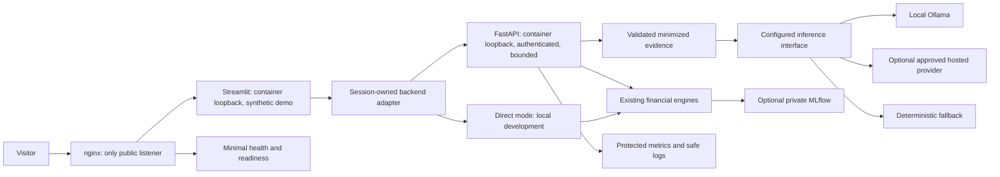

# Portfolio Phase 9 architecture and audit

Milestone A inspected on October 19, 2026. This portfolio phase follows the contest
release; it does not rewrite the contest commits, articles, or historical reports.
Work is local on `portfolio-phase9`, based on published commit
`9ac77b87860f838e7f72f5300ed043f0fa154ccd`. No deployment or paid service is authorized.

## Verified baseline

Executed the existing suite: **458 passed, zero failures, zero skips, 69.46 seconds**.
Two upstream deprecation warnings concern Starlette/HTTPX and MLflow/SQLAlchemy.
The private JUnit result is `var/portfolio-phase9/baseline.xml`.
Initial application commit `8e514ca` passed hosted GitHub Actions quality and container
jobs in [run 39152906679](https://github.com/MoAftab-01/CashGuard-AI/actions/runs/39152906679).
This historical result does not verify subsequent portfolio changes.

## Existing capabilities and startup

| Area | Existing implementation | Preserve |
|---|---|---|
| UI | `app.py`, `src/ui/*`, `src/visualizations.py` | Nine pages, Plotly, session caches, onboarding and local execution |
| Data | `src/data_processing.py`, `src/metrics.py` | Exact money, duplicate review, CSV validation and spreadsheet-safe export |
| Financial engines | `forecasting`, `calibrated_anomalies`, `risk_engine`, `scenario_simulator` | Numerical behavior and chronological safeguards |
| API | `api/main.py`, `api/policy.py`, `api/services/analytics_service.py` | Validated, stateless service wrappers around existing engines |
| Client | `src/api_client.py` | Typed contracts, response-size bound, no redirects/proxies, explicit fallback |
| AI | `financial_context`, `insight_prompts`, `llm_service`, `insight_workflow` | Minimized evidence, numeric validation, real local Ollama and deterministic fallback |
| Operations | `observability`, `experiment_tracking`, `model_monitoring` | Bounded Prometheus labels, private aggregates, offline drift diagnostics |
| Packaging | Docker runtime/tracking stages, Compose, pinned lockfiles, CI | Non-root containers and reproducible testing |

Local commands remain `python -m streamlit run app.py`, `python -m api`, and
`docker compose --profile tracking up --build`. MLflow is optional and local.
Runtime uses pandas, NumPy, scikit-learn, Pydantic, requests, FastAPI, Streamlit,
Plotly and prometheus-client; MLflow remains in the optional tracking image.

## Audit findings before portfolio changes

| Finding | Consequence / planned treatment |
|---|---|
| UI calls engines directly; API client is not wired into pages | Add a UI-independent adapter and migrate supported workflows with parity checks; retain direct mode |
| Existing responses omit recurrence/reference details used by UI | Extend transport with a separate typed dashboard contract; preserve original v1 contracts |
| Settings/client only permit literal loopback | Add explicit hosted endpoint policy; retain restrictive local defaults and reject credentialed/redirecting URLs |
| `/metrics`, `/docs`, OpenAPI and analytics have no authentication | Authenticate hosted API access and protect operational routes; minimal public health responses |
| API byte/concurrency bounds exist, but no rate limits | Add bounded per-client/global budgets; do not trust arbitrary forwarded-IP headers |
| UI accepts uploads; CSV validator allows 10 MiB while API allows 1 MiB/2,000 rows | Apply consistent hosted limits and disable uploads entirely in synthetic public mode, on both UI and API |
| Session caches belong to `st.session_state` | Preserve this ownership; no globally cached user clients, financial inputs, model outputs or trained pipelines |
| Local Ollama requires multi-GB weights and substantial RAM | Keep optional; public defaults use deterministic fallback; research an explicitly enabled hosted provider |
| MLflow uses local SQLite/artifact storage and has no built-in auth here | Never include it in public deployment; retain private local tracking |
| Compose only publishes loopback ports and does not route dashboard to API | Add a separate public-demo/staging configuration rather than weaken local Compose |
| Current metrics cover latency/model availability, not request budgets/resource use | Add bounded operational signals and failure/load tests without payload labels |

The initial audit had no current dependency-advisory scan. The subsequent OSV query
of 50 locked runtime packages returned zero advisories; it does not scan OS packages
or certify security. Passing tests do not establish absence of all vulnerabilities.
Legacy recorded benchmark results are synthetic.

## Intended boundaries

Only public synthetic data can enter the hosted demo. Financial payloads are
request-scoped in the API and session-scoped in the UI, without shared result caches
or persistence. Hosted inference must be explicit, bounded and disabled by default.

## Milestones

| Milestone | State | Verification |
|---|---|---|
| A: audit | Complete | Existing suite 458 passed; architecture/security/deployment gaps inspected |
| B: API-first | Implemented | Overview 10 checks; forecast 31; anomalies 14; risk 24; scenarios 38; AI/API regression 88; final adapter/client gate 31 passed |
| C: public-demo security | Implemented and locally verified | 46 targeted checks; independent API policy and live restricted-ingress checks passed |
| D: inference | Implemented | 101 provider/API/model checks passed; no paid or live hosted inference executed |
| E: deployment | Prepared and locally tested | Configuration checks and original/runtime/tracking/portfolio builds passed; restricted staging ingress exercised; no cloud deployment |
| F: reliability | Implemented | 49 targeted checks; local 12-request normal and 18-request overload probes exercised bounded backpressure |
| G: experience | Implemented | 37 UI/integration checks passed; guided onboarding and session clearing verified |
| H: quality gates | Local gates complete | 512 Windows + 512 Linux tests; 36 browser layouts; builds, synthetic evaluation, real local Gemma and boundary/load checks passed; cloud remains untested |
| I: documentation | Complete | README and architecture/security/deployment/testing guides; actual evidence and remaining cloud limitations |

## Milestone B implementation

`src/dashboard_backend.py` now routes imports, overview, forecast, anomaly review,
risk, scenarios and explicit insight generation through `ApiClient` in API mode.
`src/dashboard_wire.py` transports existing engine outputs as JSON with exact Decimal
money, date/dtype metadata and nullable warmup flags. New supplemental routes preserve
the original v1 response contracts. The adapter performs no financial calculations.
No implicit direct fallback is used. Direct local mode remains the default.

Transport retries are explicitly bounded to zero through two and apply only to safe
analytics/metadata operations. Inference is never automatically retried. Session-owned
cache keys include backend identity and financial parameters; cached AI text is
invalidated when evidence changes. Tests verify parity, changed thresholds, cutoffs,
reference explanations, unchanged scenario history and no automatic AI generation.

Interactive model-evaluation backtests remain a local workflow: they had no existing
API contract. Public mode shows recorded synthetic evidence instead of accepting
user-controlled backtests. This preserves the local capability and bounds demo compute.
